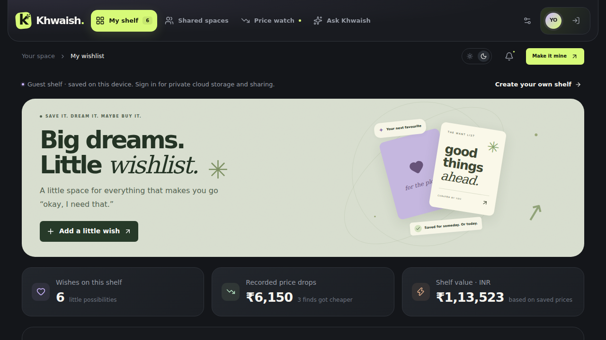
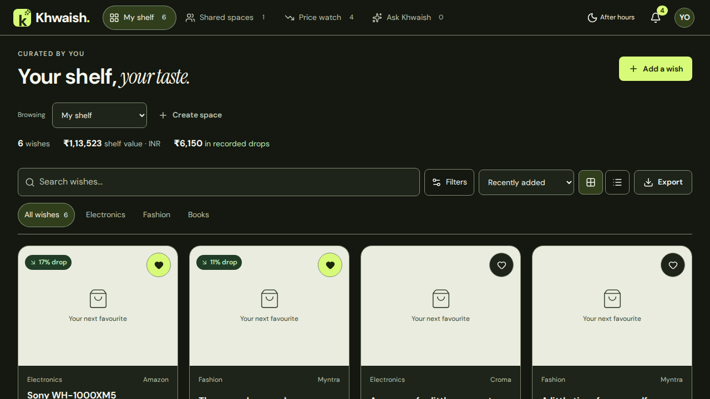

# Khwaish UI/UX refinement — 20 October 2026

The seven-phase refinement keeps the existing application features and service contracts. The public name remains **Khwaish**, with the lime accent, After hours / Daydream themes, and a local serif-italic accent font.

## Verification results

| Check                                      | Result                                                                                       |
| ------------------------------------------ | -------------------------------------------------------------------------------------------- |
| `npm run typecheck`                        | PASS                                                                                         |
| `npm test`                                 | PASS — all 13 existing tests                                                                 |
| `npm run build`                            | PASS — clean production build                                                                |
| Browser interactions                       | PASS — 40 checks, plus two checks of the 450px product-placement target                      |
| Responsive screenshots                     | 304 baseline + 372 after, including four supplemental interaction screenshots                |
| Browser matrix                             | 375, 768, 1280, 1920px, both themes; additional 320px interaction run                        |
| Text sizing / page overflow                | PASS — no visible text below 12px and no horizontal page overflow in the final capture audit |
| Contrast script                            | PASS — 80 colour-role combinations; text at least 4.5:1, UI borders at least 3:1             |
| Protected source boundaries                | PASS — all 28 files under API, lib, Supabase, and tests are byte-for-byte unchanged          |
| Storage keys                               | PASS — the four existing `khwahish:` keys are unchanged                                      |
| Application runtime errors in browser runs | None                                                                                         |

At **1280×720**, the first product starts at **443px**, compared with **929px** before. The single sticky header is **64px**.

The first build attempt encountered the workspace's Turbopack persistence-cache error. Moving the generated cache aside and rebuilding from scratch succeeded; no application code was changed to bypass the build.

Browser screenshots use eight synthetic wishes and one synthetic shared space. Remote product images were blocked consistently during capture, so screenshots deliberately demonstrate the image fallback. The test account, comments, prices, members, and offers are fixtures, not live account data. Next.js development controls are hidden in screenshots only.

## Changes by phase

| Phase                        | Result                                                                                                                                                                                                                                                                                                                                                                                                                                                                                                                                                  |
| ---------------------------- | ------------------------------------------------------------------------------------------------------------------------------------------------------------------------------------------------------------------------------------------------------------------------------------------------------------------------------------------------------------------------------------------------------------------------------------------------------------------------------------------------------------------------------------------------------- |
| 1 — Design system            | Replaced globals/refinements conflicts with ordered tokens, base, layout, components, and pages layers. Bundled DM Sans and Instrument Serif italic through `next/font/local`. Added semantic colours, 4px spacing tokens, 8/12/20px radii plus pill, three elevations, motion and z-index tokens. Three responsive boundaries: 640 / 1024 / 1440px. No new `!important`, Georgia, or external font imports.                                                                                                                                            |
| 2 — Shell                    | One sticky header: wordmark, four counted desktop tabs, theme control, price-drop bell, one account control. Removed the second header, breadcrumb and duplicate avatar. Full mobile tab labels and a native account popover presented as a mobile sheet.                                                                                                                                                                                                                                                                                               |
| 3 — Shelf/cards              | Compact heading with one Add a wish CTA, a visible shelf/space switcher, inline stats, a sticky search/filter/sort/export toolbar, category tabs, and retained grid/list modes. Consistent image ratio, readable prices and drop badges, Must-have heart tooltip, visible keyboard focus and touch targets. The decorative banner appears only on an empty shelf.                                                                                                                                                                                       |
| 4 — Price watch/spaces       | Dedicated monitoring rows, saved/latest/change/target/last-check details, target progress, existing Check price action, and five segments. Its scope explicitly includes the shelf and all spaces, excluding purchased and paused wishes. Shared cards auto-fill, show loaded role/ownership/count/INR total, and provide Open, People, and Remove space in overflow.                                                                                                                                                                                   |
| 5 — Ask                      | CSS-only flexible viewport layout, scrolling conversation, pinned composer, data-derived examples shared with the placeholder, retained scope/clear/attachments/pending/fallback. Public labels are AI and Local match. Removed JavaScript height measurement.                                                                                                                                                                                                                                                                                          |
| 6 — Details/dialogs/feedback | Product-name sheet title; sticky close header; top image/price/actions; arrow/Home/End keyboard tabs. Details use a single staged form for status, priority, tracking and the other editable fields, with Save changes / Discard when dirty. One ConfirmDialog for wish, space and message removal. One Toast with success/error/info, correct live roles, five-second duration and pause on hover/focus. Dialogs use native modal focus containment and return focus. Capture has visible OCR progress and clearer consent, including clipboard paths. |
| 7 — Polish/accessibility     | Fixed the narrow mobile heading, compressed desktop monitoring rows, reduced-motion card behaviour, disabled action styling, notification placement above active dialogs, zero-value treatment, and settings loading/error states. Added reproducible browser/contrast scripts, fixtures, screenshots and this report.                                                                                                                                                                                                                                  |

Phase commits:

- Phase 1: [99874ab](https://github.com/Prxx09/Khwaish/commit/99874abae21fe182240b07debf1bda417b086fb6) — style(ui): phase 1 — introduce tokens, bundled fonts and ordered CSS layers
- Phase 2: [6d899b0](https://github.com/Prxx09/Khwaish/commit/6d899b072dad111db2b25f0f78b09f987727c495) — refactor(ui): phase 2 — unify header, navigation and account sheet
- Phase 3: [b5b4070](https://github.com/Prxx09/Khwaish/commit/b5b4070250290bfb55895a64102d5e87c65c2540) — refactor(ui): phase 3 — compact Shelf, space switcher, filters and readable wish cards
- Phase 4: [3c4701e](https://github.com/Prxx09/Khwaish/commit/3c4701ecb43d034bbbf3f59c66e8fac8407471b3) — refactor(ui): phase 4 — monitoring rows and role-aware shared spaces
- Phase 5: [5d6d145](https://github.com/Prxx09/Khwaish/commit/5d6d1450c6f3ec68d991a6aea524524e09785d3d) — refactor(ui): phase 5 — CSS-only chat and scope-derived suggestions
- Phase 6: [66b514b](https://github.com/Prxx09/Khwaish/commit/66b514b2756322ec08aad139532b99c141df636c) — refactor(ui): phase 6 — unified detail save model, accessible dialogs and feedback
- Phase 7 is the final polish/review commit containing this report.

## Before / after

The downloadable review bundle contains an offline gallery: unzip it and open **index.html**, then select a width, theme, and state. It includes every view and dialog, empty/loading/error states, edited details, confirmations, sharing/invites, and AI pending/fallback examples.

Representative repository captures:

| Area                            | Before                                       | After                                      |
| ------------------------------- | -------------------------------------------- | ------------------------------------------ |
| Shelf, desktop, After hours     | [Before](ui-review/before-shelf-desktop.png) | [After](ui-review/after-shelf-desktop.png) |
| Shared spaces, mobile, Daydream | [Before](ui-review/before-spaces-mobile.png) | [After](ui-review/after-spaces-mobile.png) |
| Price watch, desktop, Daydream  | [Before](ui-review/before-watch-desktop.png) | [After](ui-review/after-watch-desktop.png) |
| Ask, mobile, Daydream           | [Before](ui-review/before-ask-mobile.png)    | [After](ui-review/after-ask-mobile.png)    |




## Feature checklist

“Fixture PASS” means the real frontend handlers were exercised with intercepted responses; it does not certify a live external service.

| Feature                                            | Result and evidence                                                                                                                                                                                                                                                               |
| -------------------------------------------------- | --------------------------------------------------------------------------------------------------------------------------------------------------------------------------------------------------------------------------------------------------------------------------------- |
| Guest mode and local persistence                   | **PASS** — manual add, edit/status save, discard, heart, deletion and reload persist using the existing keys.                                                                                                                                                                     |
| Signed-in mode                                     | **Fixture PASS** — loaded account, wishes, membership roles, profile/settings and service status.                                                                                                                                                                                 |
| Email sign-in, signup, recovery, profile/password  | **Presentation PASS / live not tested** — all auth modes and settings captured; existing handlers and request contracts retained. No real confirmation or recovery email was sent.                                                                                                |
| Personal shelf and shared spaces                   | **PASS** — scope switcher and desktop/mobile navigation; **fixture PASS** for role-aware signed-in views.                                                                                                                                                                         |
| Invites, revoke, member roles/removal              | **Fixture PASS** — create/copy returned invite, revoke pending invite, change role and remove member. Space creation form and space-removal confirmation captured; live create/delete transactions not exercised.                                                                 |
| Invite banner and join                             | **PASS** — token persistence and dismissal; guest join opens sign-in. Existing accept-invite handler retained; live membership acceptance not tested.                                                                                                                             |
| Add wish manually                                  | **PASS** — save and reload on this device. All extra fields retained.                                                                                                                                                                                                             |
| Link preview                                       | **Presentation PASS / live fetch not tested** — preview/review/error paths and callback retained. Metadata API and parsing tests unchanged.                                                                                                                                       |
| Screenshot OCR: file, drop, paste, clipboard       | **Regression/source PASS; live OCR not certified** — file validation captured, all entry handlers retained, OCR parser/grounding tests pass. External OCR worker/model downloads, actual desktop clipboard contents, and live AI extraction were not certified by this UI review. |
| Edit/delete/status/priority/tracking               | **PASS (guest)** — staged Details form, saved status, discard, heart and removal. Tracking control and disabled explanations retained; scheduled worker is unchanged.                                                                                                             |
| Search, filters, sorting, grid/list, category tabs | **PASS** — functional browser checks and captures.                                                                                                                                                                                                                                |
| Price check/history/drop stats                     | **Fixture PASS** — existing API receives the wish ID, updates feedback, history remains available, segments and scope captured. Live retailer access not tested.                                                                                                                  |
| Compare and store searches                         | **Fixture PASS** — offer rendering and all four retailer discovery links. Live provider matching not tested.                                                                                                                                                                      |
| Comments: add/delete/clear own messages            | **Fixture PASS** — existing handlers and confirmations exercised. Guest restriction explained.                                                                                                                                                                                    |
| Ask: AI, local fallback, scope, clear, attachments | **PASS local / fixture PASS AI** — response, pending, fallback error toast, scoped suggestions, attachment opening and clearing. Live LLM inference not called.                                                                                                                   |
| CSV export                                         | **PASS** — browser download uses Khwaish-wishlist.csv and the existing exporter.                                                                                                                                                                                                  |
| Themes                                             | **PASS** — both themes captured and toggle persists to the existing theme key.                                                                                                                                                                                                    |
| Realtime reload                                    | **SOURCE PRESERVED / live not tested** — subscription, focus reload and account-loading handlers retained; no live database event was generated.                                                                                                                                  |
| Settings                                           | **PASS presentation** — guest and fixture account views, themes, profile/password controls, export, sign-out, and explicit loading/error states retained. Live profile/password writes not performed.                                                                             |

## Decisions and review notes

- Internal names and wire values remain unchanged: personal/shared kinds, high/medium/low priorities, existing statuses, props, callbacks, and `khwahish:` storage keys. Only visible copy adopts Shelf / Space / Wish and the new priority labels.
- Guest account guidance now lives in the single account menu and relevant disabled-action helpers. The repeated banner was removed to keep products visible.
- Space creation/sharing still requires sign-in. Seeded guest spaces can be browsed; this does not grant server access.
- Price watch preserves its original active-wish scope. Totals are labelled INR, and are derived only from already loaded INR records.
- All Details edits intentionally save together. Unsaved close asks for discard confirmation; switching detail tabs retains the draft.
- User-entered product/space names remain data. Public assistant labels hide the provider name; AI-consent text still states that recognised text leaves the device when enabled.
- No new backend queries, migrations, endpoints, data models, credentials, or scheduled jobs were added.
- Screenshot coverage is Chromium at the requested CSS widths. Safari, Firefox, physical-device keyboards, real auth delivery, live OCR/LLM/retailer services and live realtime events remain follow-up checks; they are not reported as passed.

## Reproduce

```sh
npm ci
npx playwright install chromium
npm run typecheck
npm test
npm run build
node scripts/ui-contrast.mjs
node scripts/ui-review.cjs
```

Guest use does not need Supabase credentials. The full review script's signed-in/loading/error fixture cases require the existing public Supabase configuration; no private key is used. The browser intercepts signed-in service requests and never writes a live review account. `UI_REVIEW_BROWSER` can point to an installed compatible Chromium executable, and `UI_REVIEW_OUTPUT` chooses the output folder. `UI_REVIEW_SMOKE_ONLY=1` runs interaction checks; `UI_REVIEW_MATRIX_ONLY=1` captures the visual matrix.

Evidence: [browser matrix](ui-review/browser-matrix.json), [interaction checks](ui-review/browser-interactions.json), [contrast results](ui-review/contrast.json). The review bundle also includes the full baseline audit.
