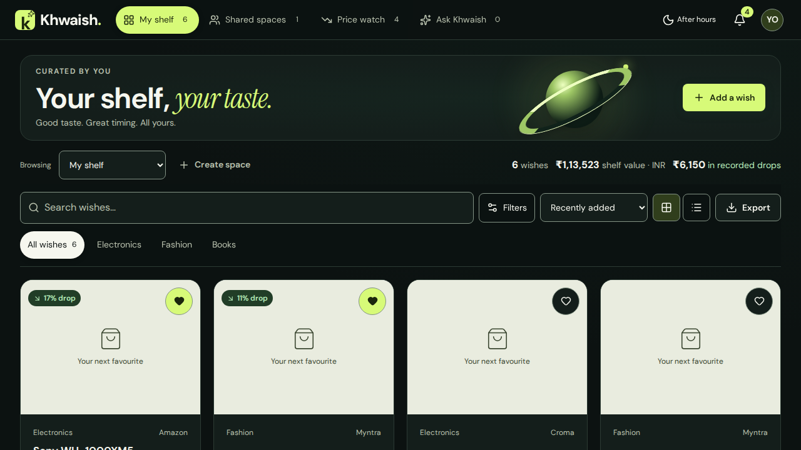
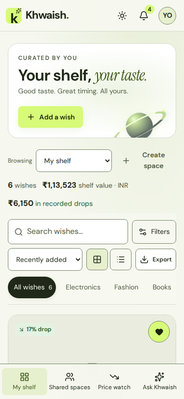

# Khwaish — video-inspired visual refinement

Reviewed both supplied videos (52.7s and 33.7s), including frame sequences showing their hover and scroll transitions. The direction combines the first reference's luminous sculptural object and image-led browsing with the second reference's deep surfaces, restrained navigation, and clear typography. Khwaish retains its lime accent, serif italic words, and After hours / Daydream themes.

## Changes

- Replaced the uniform olive surfaces with a green-black canvas, ambient lighting, quieter decorative edges, and translucent sticky navigation.
- Added a compact shelf masthead with a CSS-rendered orbit sculpture; reused the sculpture in Ask Khwaish. No video downloads, canvas render loop, new library, or external artwork is required.
- Combined the scope switcher and existing stats into a desktop row to keep products visible early. The first card begins at approximately 447px at 1280×720.
- Gave wish images varied neutral backdrops, zoom on hover, a keyboard-visible “Take a closer look” reveal, and elevated cards with a clearer price block.
- Added restrained scroll-linked reveals where supported, button press feedback, dialog entrance transitions, and hover treatment for spaces, price rows, and chat suggestions. Unsupported browsers retain the regular entrance effect. Reduced-motion preferences disable the decorative animation and transitions.
- Kept every handler, data query, backend file, storage key, and existing feature contract unchanged.

## Verification

- TypeScript, all 13 existing tests, and production build pass.
- All 40 browser interaction checks pass, including guest persistence, editing, deletion, filters, sorting, export, chat, detail tabs, price checks, comments, and sharing controls.
- 188 screenshots: 375 / 768 / 1280 / 1920px, both themes, and empty/loading/error view states; additional 320px overflow check passes.
- No page overflow, visible text below 12px, or browser runtime errors in the clean run.
- All 80 semantic colour contrast checks pass. Low-contrast decorative edges are separate from accessible input boundaries and focus rings.

Signed-in service responses are fixtures. This verifies UI connections without live account mutations, retailer requests, OCR model downloads, or real AI calls. Screenshot product images deliberately use the existing fallback because remote image requests are blocked in the review harness.

The first browser attempt needed a missing Chromium executable restored. An interrupted interaction run was repeated; the existing generated Turbopack persistence cache also needed moving aside. The clean browser run passed without source workarounds.

## Screenshots

The preceding design is recorded in [the earlier review](ui-refinement-report.md).

## Design decisions

The videos are visual references, rather than layouts to copy literally: a large marketing landing page would push saved wishes below the fold. The sculpture is decorative, does not intercept input, and requires no new data. Motion supports browsing and feedback while keeping the existing application structure and controls familiar.
